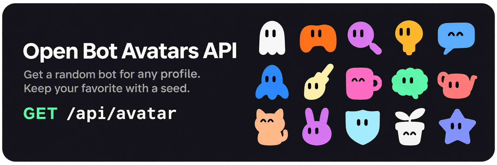

<p></p>

# OpenBot Avatars API

Bot avatars for profile pictures, chat interfaces, and apps. Open source, MIT licensed. No API key required.

- **47 designs** from Open Bot Avatar, Libraries.dev, and six first-party originals.
- **Transparent PNGs**, repeatable seeds, and reusable image URLs.
- **Fluffy Open Bot PNGs in v5**, baked once and ready to embed without WebGL.
- **Live editor** with animation, colors, moods, and PNG/SVG downloads from [Open Bot Avatar](https://github.com/DominikScholz/open-bot-avatar) 

<p></p>

## Use an avatar

```html

```

The [hosted API](https://open-bot-avatars-api.vercel.app/) returns a transparent 512 × 512 PNG, ready to use in your app.

| Endpoint | Result |
| --- | --- |
| `/api/avatar?v=5` | Random flat avatar from the frozen 47-design v5 catalog. |
| `/api/avatar?v=5&seed=user-42` | Repeatable avatar for a public seed. |
| `/api/avatar?v=5&collection=open-bot-avatar&avatar=mug&style=fluffy` | A fluffy mug as a transparent PNG. |
| `/api/avatars?v=5` | v5 catalog, valid format/style pairs, and image URLs. |
| `/api/avatar` and `/api/avatars` | Default to v5, including seed-only requests. |

Save the response's `Content-Location` URL to keep the same avatar. Open Bot flat designs also support `format=svg`; Libraries.dev supports `style=original` for plush PNGs. Hosted images use fixed poses and original colors; editor changes apply to the live preview.

In v5, Open Bot supports flat PNG, flat SVG, and fluffy PNG; Libraries.dev supports flat and original plush PNG. `style=flat` remains the default. Fluffy SVG and Libraries.dev fluffy requests return a readable 400. Use each catalog entry's `variants` pairs rather than multiplying its `formats` and `styles` summaries. `fluffyUrl` and `originalUrl` are null where unavailable.

The API and picker default to v5. Shared exact and seeded links include the version and finish. Versions 1 through 3 are no longer supported. Fluffy previews animate by default. **Preview PNG** shows the actual returned image on demand, and **Show animation** returns to the live preview. Live fur may fall back to flat without WebGL2; copied URLs and downloads keep the fluffy finish. Editor SVG exports remain explicitly flat. Include `v=5` in saved URLs to preserve selections when future versions are added.

## Development

Requires Node.js 24 and npm.

```sh
npm ci
npm run dev
```

Open [localhost:3000](http://localhost:3000) to browse avatars, try the editor, and read the API docs.

The [editor](https://open-bot-avatars-api.vercel.app/editor) exports the current preview as a transparent PNG or a flat SVG. The [API docs](https://open-bot-avatars-api.vercel.app/docs) include copyable integration examples. Selections stay in place when switching between these pages.

```sh
npm test
npm run build
npm start
```

For desktop and mobile browser checks, build the app first, then run:

```sh
npx playwright install chromium
npm run test:e2e
```

Version 4 stays frozen at 41 designs; all 18 saved seed fixtures and 187 asset hashes are checked against it. Version 5 adds mushroom, jellybean, ringed planet, lighthouse, sailboat, and teapot for 47 designs, 123 image variants, and 94 API thumbnails. V5 also freezes 18 seed selections and 223 asset hashes, including 6 posed editor thumbnails. Both endpoints and the picker default to v5. Save explicit versioned URLs to preserve selections.

First-party geometry and colors live in [originals.json](app/lib/originals.json), separate from the upstream snapshot. Run `npm run review:originals` for schema checks, conservative face-envelope checks, and a 32 px silhouette sheet alongside the existing gallery. Add `-- --finishes` to review flat/fluffy sizes and turned mood/gaze poses. The upstream strict validator requires a separate upstream checkout and is not included here.

Run `npm run generate:v5` on the pinned Node `v24.17.0`, Playwright `1.58.2`, Chromium `145.0.7632.6` and renderer `0.4.0` with WebGL2. The bake copies v4 bytes into v5, generates only the six new definitions, verifies real fur against disabled-WebGL controls, and creates API and posed editor thumbnails. Existing release files must match exactly on reruns. Review sheets and GPU evidence live in `experiments/v5-originals/`. The original v4 bake remains `npm run generate:v4`. Requests only read saved assets. Run `npm run validate:catalog`, `npm test`, `npm run build`, then `npm run test:e2e` before release.

To measure a production build with WebGL enabled, run `node scripts/measure-performance.mjs experiments/performance-next`. It starts and stops its own local server on port 3111 and records three runs per scenario on desktop and throttled mobile emulation. `api-fluffy-live` measures the default fluffy animation; `api-fluffy` measures the on-demand PNG after clicking Preview PNG. JSON and screenshots are saved. Optionally append comma-separated scenarios, such as `api-flat,api-fluffy-live`, to repeat a subset. Use a fresh output directory each time. Emulation does not replace a physical-phone baseline; see `improvements.md` for results and limits.

For deployment, set `SITE_URL` to your public origin before building. Vercel detects its production domain automatically. Include the `public` directory with your deployment.

Both API endpoints share a limit of **180 requests per minute per client IP**. Excess requests return `429` with `Retry-After`. On Vercel, configure `UPSTASH_REDIS_REST_URL` and `UPSTASH_REDIS_REST_TOKEN` for a shared limiter; missing credentials or a store outage return `503`. Local development uses a bounded in-memory limiter. See [.env.example](.env.example). Only trust IP headers overwritten by your hosting platform. Cached images and static assets do not consume the function quota; use Vercel Firewall for traffic protection before requests reach the app.

## Credits

Built by Lakshman Bhukya, using artwork and renderers from [Open Bot Avatar](https://github.com/DominikScholz/open-bot-avatar) and [Libraries.dev](https://github.com/Jakubantalik/Libraries.dev/tree/main/packages/bot-avatars). The six first-party silhouettes are available under this project's MIT license.

[MIT license](LICENSE) · [Third-party notices](THIRD_PARTY_NOTICES.md)
