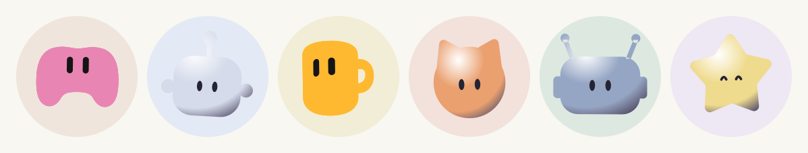

# Open Bot Avatars API

Give each profile a bot of its own. A single request returns a 512 × 512 SVG from 25 base designs. Pick one at random, assign one from a public user ID, or shuffle and download favorites on the homepage.



## Put a bot on a profile

On the homepage, shuffle to a bot you like and select **Copy profile URL** to keep it. Use **Download PNG** for a transparent 512 × 512 upload or **Download SVG** for the scalable image.

With the app running locally, this image displays the same avatar each time the profile opens. Replace `localhost:3000` with your deployment host when you publish.

```html

```

| Request | Result |
| --- | --- |
| `GET /api/avatar` | A fresh random SVG on each request. |
| `GET /api/avatar?seed=user-42&v=2` | A repeatable avatar from the full collection. |
| `GET /api/avatar?seed=user-42` | A repeatable avatar from the original seven designs. |

To keep a random pick, save the relative URL in its `Content-Location` response header. Resolve it against the API host if your profile page lives on another domain. Seeds appear in URLs, so use a public identifier. The endpoint accepts one seed between 1 and 128 characters.

## Run locally

Using Node.js 24 and npm, run these commands from the project directory.

```sh
npm ci
npm run dev
```

Open the [local avatar picker](http://localhost:3000). Run `npm test` for the API checks, or `npm run build` followed by `npm start` to serve the production build.

## Artwork and license

The API uses Dominik Scholz’s renderer and seven starter designs from [Open Bot Avatar](https://github.com/DominikScholz/open-bot-avatar). The other 18 designs adapt Jakub Antalik’s shape outlines and face presets into static SVG profile pictures. [Libraries.dev Bot Avatars](https://github.com/Jakubantalik/Libraries.dev/tree/main/packages/bot-avatars)

You can use, modify, and redistribute this project under the MIT License. Include the applicable copyright and permission notices when sharing copies or substantial portions. [Project license](LICENSE) · [Third-party notices](THIRD_PARTY_NOTICES.md)
