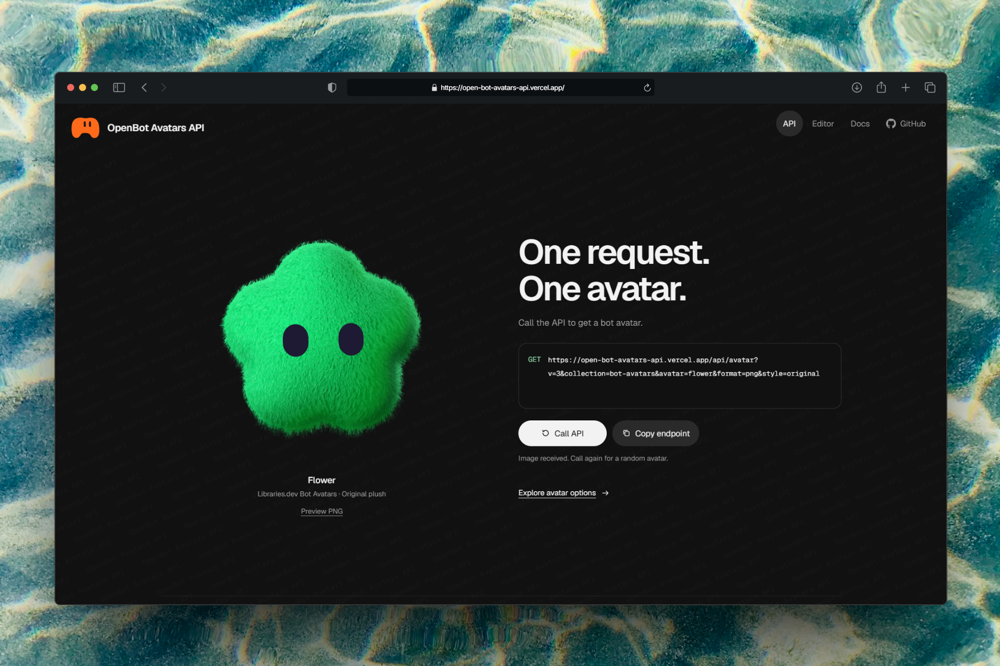

<p></p>

# OpenBot Avatars API

Bot avatars for profile pictures, chat interfaces, and apps. Open source, MIT licensed. No API key required.

- **41 designs** from Open Bot Avatar and Libraries.dev.
- **Transparent PNGs**, repeatable seeds, and reusable image URLs.
- **Fluffy Open Bot PNGs in v4**, baked once and ready to embed without WebGL.
- **Live editor** with animation, colors, moods, and PNG/SVG downloads from [Open Bot Avatar](https://github.com/DominikScholz/open-bot-avatar) 

<p></p>

## Use an avatar

```html

```

The [hosted API](https://open-bot-avatars-api.vercel.app/) returns a transparent 512 × 512 PNG, ready to use in your app.

| Endpoint | Result |
| --- | --- |
| `/api/avatar?v=4` | Random flat avatar from the frozen 41-design v4 catalog. |
| `/api/avatar?v=4&seed=user-42` | Repeatable avatar for a public seed. |
| `/api/avatar?v=4&collection=open-bot-avatar&avatar=mug&style=fluffy` | A fluffy mug as a transparent PNG. |
| `/api/avatars?v=4` | v4 catalog, valid format/style pairs, and image URLs. |
| `/api/avatar` and `/api/avatars` | Retain v3 behavior for existing integrations. |

Save the response's `Content-Location` URL to keep the same avatar. Open Bot flat designs also support `format=svg`; Libraries.dev supports `style=original` for plush PNGs. Hosted images use fixed poses and original colors; editor changes apply to the live preview.

In v4, Open Bot supports flat PNG, flat SVG, and fluffy PNG; Libraries.dev supports flat and original plush PNG. `style=flat` remains the default. Fluffy SVG and Libraries.dev fluffy requests return a readable 400. Use each catalog entry's `variants` pairs rather than multiplying its `formats` and `styles` summaries. `fluffyUrl` and `originalUrl` are null where unavailable.

New picker selections use v4. Shared exact and seeded links include the version and finish; saved v3 and unversioned picker selections retain v3. Fluffy previews animate by default. **Preview PNG** shows the actual returned image on demand, and **Show animation** returns to the live preview. Live fur may fall back to flat without WebGL2; copied URLs and downloads keep the fluffy finish. Editor SVG exports remain explicitly flat. Unversioned seed-only image requests retain their legacy mapping; use explicit v4 for new seeds and fluffy images.

## Development

Requires Node.js 24 and npm.

```sh
npm ci
npm run dev
```

Open [localhost:3000](http://localhost:3000) to browse avatars, try the editor, and read the API docs.

The [editor](https://open-bot-avatars-api.vercel.app/editor) exports the current preview as a transparent PNG or a flat SVG. The [API docs](https://open-bot-avatars-api.vercel.app/docs) include copyable integration examples. Selections stay in place when switching between these pages.

```sh
npm test
npm run build
npm start
```

For desktop and mobile browser checks, build the app first, then run:

```sh
npx playwright install chromium
npm run test:e2e
```

Versions 3 and 4 use separate frozen catalogs, source metadata, and asset directories. Keep each version's candidate order and eligibility unchanged; additional designs require v5. `npm run validate:catalog` checks v3 (41 designs, 82 images, 59 thumbnails) and v4 (41 designs, 105 images, 82 thumbnails), plus all 328 saved asset hashes. `npm test` also checks legacy/unversioned responses and frozen v3/v4 seed fixtures. `GET /api/avatars` remains v3; request `?v=4` for the new catalog.

The fluffy bake is `npm run generate:v4`, using the pinned Node `v24.17.0`, Playwright `1.58.2`, full Chromium `145.0.7632.6`, and renderer `0.4.0` on a WebGL2-capable machine. It renders one definition at a time through public `mountAvatar`, compares every GPU coat against a WebGL-disabled fluffy request, rejects blank/fallback/clipped output, and stages files before creating v4 assets. Existing v4 files must match exactly on reruns. Review the 512 px and 64 px contact sheets in `experiments/v4-fluffy/`; requests only read saved files and never launch this renderer.

To measure a production build with WebGL enabled, run `node scripts/measure-performance.mjs experiments/performance-next`. It starts and stops its own local server on port 3111 and records three runs per scenario on desktop and throttled mobile emulation. `api-fluffy-live` measures the default fluffy animation; `api-fluffy` measures the on-demand PNG after clicking Preview PNG. JSON and screenshots are saved. Optionally append comma-separated scenarios, such as `api-flat,api-fluffy-live`, to repeat a subset. Use a fresh output directory each time. Emulation does not replace a physical-phone baseline; see `improvements.md` for results and limits.

For deployment, set `SITE_URL` to your public origin before building. Vercel detects its production domain automatically. Include the `public` directory with your deployment.

Both API endpoints share a limit of **180 requests per minute per client IP**. Excess requests return `429` with `Retry-After`. On Vercel, configure `UPSTASH_REDIS_REST_URL` and `UPSTASH_REDIS_REST_TOKEN` for a shared limiter; missing credentials or a store outage return `503`. Local development uses a bounded in-memory limiter. See [.env.example](.env.example). Only trust IP headers overwritten by your hosting platform. Cached images and static assets do not consume the function quota; use Vercel Firewall for traffic protection before requests reach the app.

## Credits

Built by Lakshman Bhukya, using artwork and renderers from [Open Bot Avatar](https://github.com/DominikScholz/open-bot-avatar) and [Libraries.dev](https://github.com/Jakubantalik/Libraries.dev/tree/main/packages/bot-avatars).

[MIT license](LICENSE) · [Third-party notices](THIRD_PARTY_NOTICES.md)
